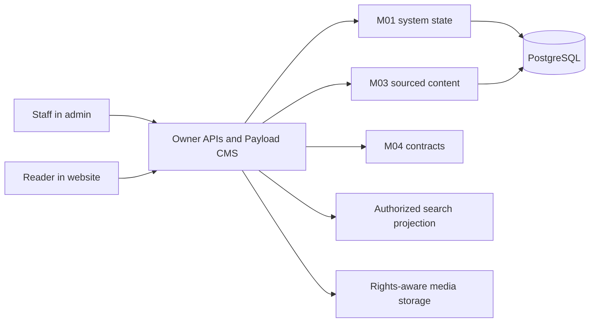

# Architecture

**Current logical architecture:** M01 System owns operational state and administration; M02 Website owns routes and presentation; M03 Content owns Dharma domain meaning and sourced knowledge; M04 defines shared semantic contracts; M05 maps specifications to source, tests and release evidence. M05 is delivery traceability, not a fifth product taxonomy. [K02 lines 9–43; K04 §3]

The admin panel hosts Payload editorial and operational screens. The website consumes published and permitted projections; it does not own payments, taxonomy, content, authorization, or private user state. The API hosts owner commands and projections, with Payload responsible for CMS behavior and custom endpoints only when owner contracts need them. [K04 §§4–5; K06 lines 67–92]

**Trust boundaries:** browsers hold untrusted input and never receive server secrets or unrestricted database access. API authorization checks principal, session, current grants, resource and field scope. Public projections exclude drafts and private fields. Provider adapters isolate payment, storage and streaming systems. [K05 D1-02/05/13; K06]

The source freezes pnpm, Turborepo, strict TypeScript, Payload CMS v3, Next.js, PostgreSQL and Payload's PostgreSQL adapter. Tailwind, Cloudflare R2, GitHub Actions and Payload jobs are preferred, not frozen. Exact HTTP framework outside Payload/Next, auth library, search engine, hosting and package versions are implementation-time decisions. [K06 lines 17–33, 67–168]

The user's `apps/website` naming and repository target supersede source references to `apps/web` and `sanskritieternal/shiv`; see [CON-001](reports/conflict-register.md). No physical schema, deployment topology or live API exists in this repository.
